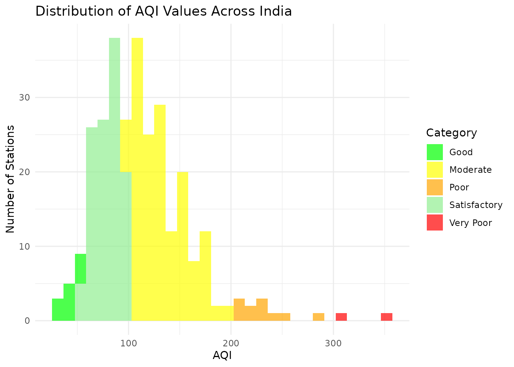
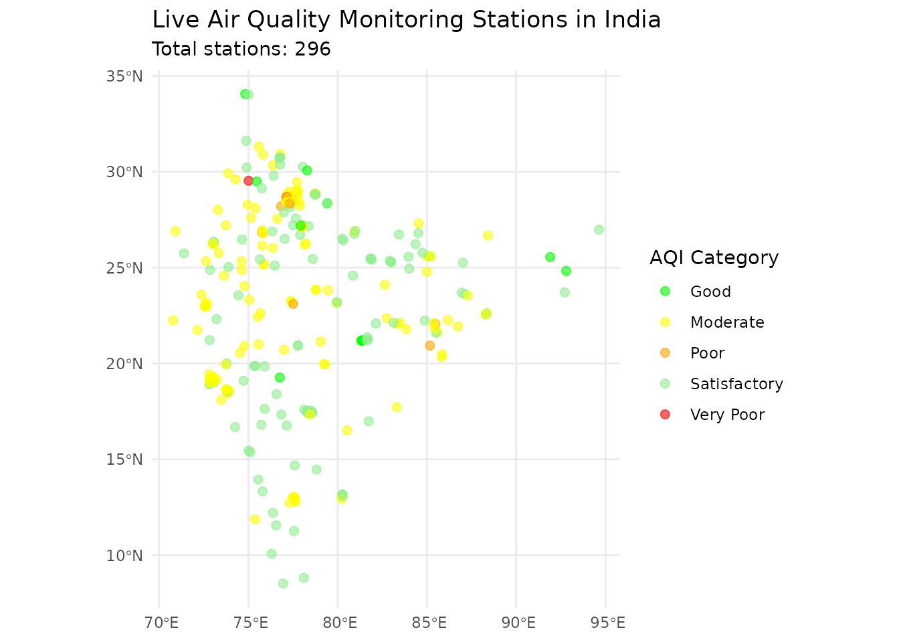

# Introduction to vayuayan

## Introduction

**vayuayan** (वायुअयन) is an R package for fetching and analyzing air
quality data from multiple sources in India. The name combines two
Sanskrit words:

- **Vayu** (वायु): Wind, air
- **Ayan** (अयन): Path, journey, movement

Together, “Vayuayan” means “the path of wind” - representing the journey
and movement of air quality data across space and time.

### Installation

``` r
# Install from GitHub
devtools::install_github("saketkc/vayuayanR")
```

### Data sources

The package provides access to:

1.  **CPCB India**: Central Pollution Control Board monitoring network
    - Historical AQI data
    - Real-time monitoring data
    - Station-level and city-level data
2.  **WUSTL ACAG**: Washington University satellite PM2.5 data
    - Global coverage
    - Monthly and annual data
    - High-resolution gridded data

### Quick start

``` r
library(vayuayan)
#> vayuayan: Air quality data analysis for India
#> Version 0.1.3
#> Use vayuayan_welcome() for quick start guide

# Display welcome message with quick start guide
vayuayan_welcome()
#> 
#> ── Vayuayan - Air quality data analysis ────────────────────────────────────────
#> Version 0.1.3
#> 
#> ── Available functions: ──
#> 
#> • cpcb_get_state_list(), cpcb_get_city_list() - Historical AQI data from CPCB
#> • cpcb_get_live_aqi_data(), cpcb_get_nearest_station() - Real-time AQI
#> monitoring
#> • pm25_get_stats(), pm25_download_netcdf() - Satellite PM2.5 data processing
#> 
#> ── Quick start: ──
#> 
#> states <- cpcb_get_state_list()
#> cities <- cpcb_get_city_list('Maharashtra')
#>  
#> location <- cpcb_get_system_location()
#> aqi <- cpcb_get_live_aqi_data()
#>  
#> stats <- pm25_get_stats('region.geojson', 2023, 11)
```

## Historical AQI data

The `cpcb_` functions provide access to historical air quality data from
the Central Pollution Control Board.

### Exploring available data

``` r
# Get list of states
states <- cpcb_get_state_list()
head(states)
#> [1] "Andaman and Nicobar" "Andhra Pradesh"      "Arunachal Pradesh"  
#> [4] "Assam"               "Bihar"               "Chandigarh"

# Get cities in Maharashtra
cities <- cpcb_get_city_list("Maharashtra")
head(cities)
#> [1] "Ahmednagar" "Akola"      "Amravati"   "Aurangabad" "Badlapur"  
#> [6] "Belapur"

# Get monitoring stations in Mumbai
stations <- cpcb_get_station_list("Mumbai")
head(stations)
#>       value                               label
#> 1 site_5810 Bandra Kurla Complex, Mumbai - MPCB
#> 2 site_5396               Deonar, Mumbai - IITM
#> 3 site_5120               Colaba, Mumbai - MPCB
#> 4 site_5113        Borivali East, Mumbai - MPCB
#> 5 site_5106      Vile Parle West, Mumbai - MPCB
#> 6 site_5961         Shivaji Nagar, Mumbai - BMC
```

#### Adding coordinates to stations

``` r
# Get coordinates for stations in Delhi (slow: ~1 req/sec to Nominatim)
delhi_station_list <- cpcb_get_station_list("Delhi")
delhi_station_list <- cpcb_add_coords(delhi_station_list)
```

### Downloading historical data

#### City-level data

``` r
# Download city-level AQI data for Mumbai in 2024
cpcb_download_city_data(
  city = "Mumbai",
  year = 2024,
  save_location = "mumbai_aqi_2024.csv"
)
```

#### Station-level data

``` r
# Download station-level data
cpcb_download_station_data(
  station_id = "site_5964",
  year = 2024,
  save_location = "station_data_2024.csv"
)
```

## Live AQI monitoring

The `cpcb_` live functions enable real-time air quality monitoring.

### Location-based monitoring

``` r
# Get your current location (IP-based)
location <- cpcb_get_system_location()
print(location)
#>       lat       lon 
#>  36.67770 -78.37471

# Find nearest monitoring station
nearest <- cpcb_get_nearest_station()
cat("Nearest Station:", nearest$station_name)
#> Nearest Station: Rajbagh, Srinagar - JKPCC
cat("Distance:", round(nearest$distance_km, 2), "km")
#> Distance: 11685.77 km
```

### Getting live AQI data

``` r
# Get live AQI data for nearest station
aqi_data <- cpcb_get_live_aqi_data()

# Display pollutant metrics
if (!is.null(aqi_data$metrics) && is.data.frame(aqi_data$metrics)) {
  for (i in seq_len(nrow(aqi_data$metrics))) {
    cat(sprintf(
      "%s: Avg=%s, Min=%s, Max=%s\n",
      aqi_data$metrics$name[i],
      aqi_data$metrics$avg[i],
      aqi_data$metrics$min[i],
      aqi_data$metrics$max[i]
    ))
  }
}
#> PM2.5: Avg=23, Min=15, Max=33
#> PM10: Avg=36, Min=23, Max=52
#> SO2: Avg=3, Min=3, Max=4
#> CO: Avg=16, Min=10, Max=24
#> OZONE: Avg=1, Min=1, Max=4

# Get AQI for specific coordinates
mumbai_coords <- c(19.0760, 72.8777)
aqi_data <- cpcb_get_live_aqi_data(coords = mumbai_coords)

# Get historical live data (specific date and hour)
aqi_data <- cpcb_get_live_aqi_data(
  station_id = "site_5964",
  date = "2024-02-25",
  hour = 10
)
```

## Data analysis with tidyverse

The package integrates seamlessly with tidyverse workflows.

### Station data analysis

``` r
library(dplyr)
#> 
#> Attaching package: 'dplyr'
#> The following objects are masked from 'package:stats':
#> 
#>     filter, lag
#> The following objects are masked from 'package:base':
#> 
#>     intersect, setdiff, setequal, union
library(ggplot2)

# Get all station data
all_stations <- cpcb_get_all_india()

# Convert to tidy dataframe
df <- stations_to_dataframe(all_stations)

# State-wise summary
state_summary <- df %>%
  group_by(state_id) %>%
  summarise(
    total_stations = n(),
    live_stations = sum(live),
    offline_stations = sum(!live),
    avg_aqi = mean(avg_aqi, na.rm = TRUE),
    .groups = "drop"
  ) %>%
  arrange(desc(live_stations))

print(head(state_summary, 10))
#> # A tibble: 10 × 5
#>    state_id       total_stations live_stations offline_stations avg_aqi
#>    <chr>                   <int>         <int>            <int>   <dbl>
#>  1 Maharashtra                98            50               48   103. 
#>  2 Uttar Pradesh              57            47               10   114. 
#>  3 Rajasthan                  46            39                7   118. 
#>  4 Delhi                      46            21               25   177  
#>  5 Karnataka                  42            16               26    92.6
#>  6 Madhya Pradesh             30            16               14   133. 
#>  7 Bihar                      35            12               23   105. 
#>  8 Odisha                     19            12                7   140. 
#>  9 Chhattisgarh               14            11                3    75  
#> 10 Gujarat                    22            11               11   123.
```

### AQI distribution analysis

``` r
# Analyze AQI distribution
df_with_categories <- df %>%
  filter(!is.na(avg_aqi)) %>%
  mutate(aqi_category = get_aqi_categories(avg_aqi))

# Category distribution
category_dist <- df_with_categories %>%
  count(aqi_category) %>%
  arrange(desc(n))

print(category_dist)
#>   aqi_category   n
#> 1     Moderate 155
#> 2 Satisfactory 116
#> 3         Good  12
#> 4         Poor  11
#> 5    Very Poor   2

# Visualize AQI distribution
ggplot(df_with_categories, aes(x = avg_aqi, fill = aqi_category)) +
  geom_histogram(bins = 30, alpha = 0.7) +
  scale_fill_manual(
    values = c(
      "Good" = "green",
      "Satisfactory" = "lightgreen",
      "Moderate" = "yellow",
      "Poor" = "orange",
      "Very Poor" = "red",
      "Severe" = "darkred"
    )
  ) +
  labs(
    title = "Distribution of AQI Values Across India",
    x = "AQI",
    y = "Number of Stations",
    fill = "Category"
  ) +
  theme_minimal()
```



## PM2.5 satellite data

The `pm25_` functions process satellite-based PM2.5 data from WUSTL
ACAG.

### Basic usage

``` r
# Get PM2.5 statistics for a region (requires GeoJSON file)
delhi_stats <- pm25_get_stats(
  geojson_file = "delhi_ncr.geojson",
  year = 2023,
  month = 11
)

print(delhi_stats)
# Output: List with mean, std, min, max PM2.5 values
```

### Grouped analysis

``` r
# Analyze PM2.5 grouped by state
state_stats <- pm25_get_stats(
  geojson_file = "india_districts.geojson",
  year = 2023,
  month = 11,
  group_by = "state_name"
)

print(head(state_stats))

# Analyze with multiple grouping columns
district_stats <- pm25_get_stats(
  geojson_file = "india_districts.geojson",
  year = 2023,
  month = 11,
  group_by = "state_name,district_name"
)
```

### Cache management

``` r
# List cached NetCDF files
pm25_list_cached_files()

# Clear cache to free disk space
pm25_clear_cache()

# Force re-download of data
pm25_download_netcdf(
  year = 2023,
  month = 11,
  force_download = TRUE
)
```

## Geospatial analysis

### Mapping monitoring stations

``` r
library(sf)
#> Linking to GEOS 3.12.1, GDAL 3.8.4, PROJ 9.4.0; sf_use_s2() is TRUE
library(ggplot2)

# Get station data
all_stations <- cpcb_get_all_india()
df <- stations_to_dataframe(all_stations)

# Filter live stations with valid coordinates
live_stations <- df %>%
  filter(live == TRUE, !is.na(longitude), !is.na(latitude)) %>%
  mutate(aqi_category = get_aqi_categories(avg_aqi))

# Convert to spatial object
stations_sf <- st_as_sf(
  live_stations,
  coords = c("longitude", "latitude"),
  crs = 4326
)

# Plot stations on map
ggplot(stations_sf) +
  geom_sf(aes(color = aqi_category), size = 2, alpha = 0.6) +
  scale_color_manual(
    values = c(
      "Good" = "green",
      "Satisfactory" = "lightgreen",
      "Moderate" = "yellow",
      "Poor" = "orange",
      "Very Poor" = "red",
      "Severe" = "darkred"
    )
  ) +
  labs(
    title = "Live Air Quality Monitoring Stations in India",
    subtitle = paste("Total stations:", nrow(stations_sf)),
    color = "AQI Category"
  ) +
  theme_minimal()
```



### Spatial filtering

``` r
# Find stations within a specific region (Maharashtra)
mh_bbox <- st_bbox(
  c(xmin = 72.5, ymin = 15.5, xmax = 80.5, ymax = 22.5),
  crs = 4326
)

mh_stations <- st_crop(stations_sf, mh_bbox)
#> Warning: attribute variables are assumed to be spatially constant throughout
#> all geometries

cat("Stations in Maharashtra region:", nrow(mh_stations))
#> Stations in Maharashtra region: 67
```

## Utility functions

### Station name cleaning

``` r
# Clean station names for file naming
clean_station_name("Dr. Karni Singh Shooting Range, Delhi - DPCC")
#> [1] "Dr_Karni_Singh_Shooting_Range_Delhi_DPCC"
# Output: "Dr_Karni_Singh_Shooting_Range_Delhi_DPCC"

clean_station_name("ITO, Delhi - DPCC")
#> [1] "ITO_Delhi_DPCC"
# Output: "ITO_Delhi_DPCC"
```

### Distance calculations

``` r
# Calculate distance between two locations (km)
mumbai <- c(19.0760, 72.8777)
delhi <- c(28.7041, 77.1025)

distance <- haversine_distance(
  mumbai[1],
  mumbai[2],
  delhi[1],
  delhi[2]
)

cat("Distance from Mumbai to Delhi:", round(distance), "km")
#> Distance from Mumbai to Delhi: 1153 km
```

### Comprehensive analysis

``` r
# Comprehensive station analysis
all_stations <- cpcb_get_all_india()

analysis <- analyze_station_data(all_stations)

# View analysis results
str(analysis)
#> List of 11
#>  $ total_cities          : int 4
#>  $ total_stations        : int 577
#>  $ live_stations         : int 296
#>  $ offline_stations      : int 281
#>  $ states                : int 32
#>  $ unique_states         : chr [1:32] "Andaman and Nicobar" "Andhra Pradesh" "Arunachal Pradesh" "Assam" ...
#>  $ stations_with_aqi_data: int 296
#>  $ avg_aqi_overall       : num 113
#>  $ min_aqi               : num 31
#>  $ max_aqi               : num 352
#>  $ aqi_categories        : 'table' int [1:6(1d)] 12 155 281 11 116 2
#>   ..- attr(*, "dimnames")=List of 1
#>   .. ..$ : chr [1:6] "Good" "Moderate" "No Data" "Poor" ...
```

## Best practices

### Error handling

``` r
# Always use tryCatch for API calls
tryCatch(
  {
    aqi_data <- cpcb_get_live_aqi_data()
    print(aqi_data$metrics)
  },
  error = function(e) {
    message("Error fetching data: ", e$message)
  }
)
#>    name avg                avgDesc min max pollutantName
#> 1 PM2.5  23 Over the last 24 hours  15  33         PM2.5
#> 2  PM10  36 Over the last 24 hours  23  52          PM10
#> 3   SO2   3 Over the last 24 hours   3   4           SO2
#> 4    CO  16  Over the last 8 hours  10  24            CO
#> 5 OZONE   1  Over the last 8 hours   1   4         OZONE
```

### Caching strategy

``` r
# Check cache before downloading
cached_files <- pm25_list_cached_files("~/.vayuayan_cache")

# Clear old cache periodically
if (length(cached_files) > 10) {
  pm25_clear_cache("~/.vayuayan_cache")
}
```

### Data validation

``` r
# Validate data before analysis
df <- stations_to_dataframe(all_stations)

# Check for missing coordinates
stations_no_coords <- df %>%
  filter(is.na(latitude) | is.na(longitude))

if (nrow(stations_no_coords) > 0) {
  warning(sprintf(
    "%d stations missing coordinates",
    nrow(stations_no_coords)
  ))
}

# Check for unrealistic AQI values
df %>%
  filter(avg_aqi < 0 | avg_aqi > 500) %>%
  nrow() -> invalid_aqi

if (invalid_aqi > 0) {
  warning(sprintf("%d stations with invalid AQI", invalid_aqi))
}
```
